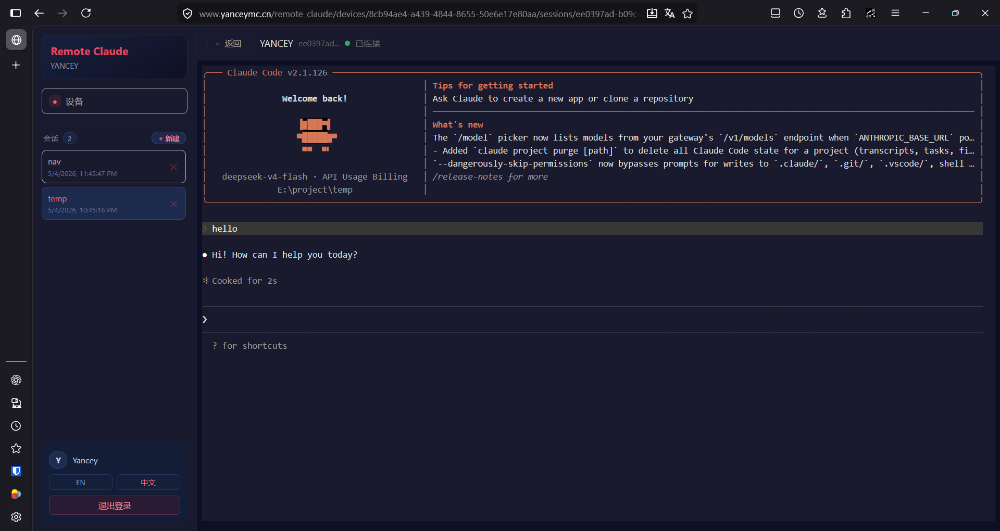
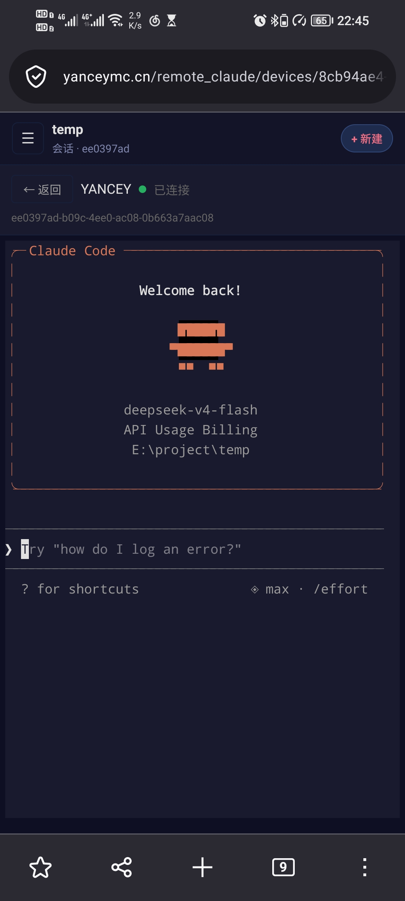

# Remote Control Claude Code

通过 WebSocket/REST 远程控制 [Claude Code](https://claude.ai/code) CLI 的中转系统。系统由 Rust 服务端、Rust 桌面客户端和 React Web UI 组成。

## 架构

```text
Web UI (React) <-- REST/WS --> remote-claude-server (Rust/Axum/SQLite)
                                      ^
                                      | WS
                                      v
                              remote-claude-client (Rust) --> Claude CLI
```

- **server**：用户鉴权、设备管理、会话路由和结果转发。
- **client**：连接服务端，在本机启动并管理 Claude CLI。
- **web-ui**：浏览器端设备管理、终端会话和实时输出。

## 界面预览

<table>
  <tr>
    <td width="70%"></td>
    <td width="30%"></td>
  </tr>
</table>

## 快速开始

```bash
# 1. 启动服务端
cd apps/server
ADMIN_USER=admin ADMIN_PASS=admin123 JWT_SECRET=change-me cargo run

# 2. 启动客户端（CLIENT_TOKEN 可从管理 API 获取）
cd ../client
CLIENT_TOKEN=<token> SERVER_URL=ws://127.0.0.1:8080/ws/client cargo run

# 3. 启动 Web UI
cd ../web
pnpm install
pnpm dev
```

Web UI 默认地址为 `http://localhost:5173`，开发代理连接 `localhost:8080`。未设置客户端令牌时，客户端会在首次启动时交互式提示输入并保存。

## Docker

```bash
docker pull yanceyawa/remote-claude
docker run -d --name remote-claude -p 8080:8080 \
  -e ADMIN_USER=admin -e ADMIN_PASS=change-me -e JWT_SECRET=change-me \
  -v claude-config:/app/config -v claude-data:/app/data \
  -v claude-downloads:/app/downloads \
  yanceyawa/remote-claude
```

详见 [部署指南](doc/deployment.md)。生产环境请替换示例凭据并使用 TLS。

## 文档

- [开发指南](doc/development.md)
- [配置说明](doc/configuration.md)
- [部署指南](doc/deployment.md)
- [REST 与 WebSocket 协议](doc/protocol.md)
- [架构说明](doc/architecture.md)
- [完整文档索引](doc/README.md)
- [变更记录](CHANGELOG.md)

## 测试

```bash
cd apps/server && cargo test
cd apps/client && cargo test
cd apps/web && pnpm test
```

## 技术栈

Rust、Axum、Tokio、sqlx、tokio-tungstenite、React、TypeScript、Vite、xterm.js、SQLite、Docker 和 Argon2。
